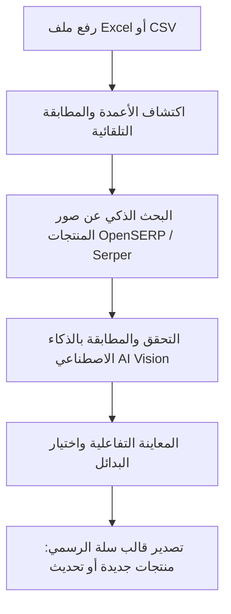

# 🛍️ Salla Smart Excel Importer & Image Finder — Desktop Engine

<div align="center">


**محرك مكتبي ذكي لمعالجة ملفات إكسل للمنتجات، البحث التلقائي عن أدق صور المنتجات ومطابقتها بالذكاء الاصطناعي، وتصدير قوالب منصة سلة (Salla) الرسمية المعتمدة بضغطة زر واحدة.**

[المميزات](#-المميزات-الرئيسية) • [طريقة التشغيل](#-طريقة-التشغيل-السريعة) • [خطوات العمل](#-خطوات-العمل-داخل-الواجهة) • [هيكل المشروع](#-هيكل-المشروع) • [متغيرات البيئة](#-إعداد-المتغيرات-البيئية-env) • [الأمان](#-الأمان-وحماية-البيانات)

</div>

---

## 📖 نبذة عن المشروع

تم تطوير هذا النظام لتوفير حل متكامل وسريع ومحلي (Desktop Standalone) لتجار منصة سلة ومديري المتاجر الإلكترونية لتجهيز آلاف المنتجات ورفعها دون عناء البحث اليدوي عن الصور وتنسيق الملفات.

يقوم المحرك بقراءة وتفسير ملفات `Excel` أو `CSV`، ثم استخراج أسماء المنتجات والباركودات، والبحث الذكي عن صور عالية الدقة من خلال مزودات بحث متعددة، والتحقق البصري منها عبر الذكاء الاصطناعي (**Gemini Vision** / **Groq**) لاستبعاد الصور غير الدقيقة أو الإعلانية، ومن ثم تعبئة وتصدير قوالب منصة سلة الرسمية فوراً وبأعلى توافقية.

---

## ✨ المميزات الرئيسية

* 📊 **تحليل ذكي واكتشاف تلقائي للأعمدة:**
  * التعرف الذكي على أسماء الأعمدة بغض النظر عن لغة أو صيغة الملف (`الاسم`, `الباركود`, `السعر`, `الكمية`, `التصنيف`, `الوصف`).
  * دعم كامل لملفات `.xlsx`, `.xls`, `.csv`.

* 🔍 **محرك بحث متطور عن الصور (Multi-Provider):**
  * دعم محرك البحث المحلي السريع **OpenSERP** (يعمل تلقائياً عند الحاجة ويغلق بعد انتهاء البحث لتوفير الموارد).
  * دعم مزود البحث السحابي **Serper API** كخيار متقدم أو بديل.
  * نظام كاش محلي فائق السرعة عبر `SQLite` لحفظ نتائج البحث وتجنب الاستعلامات المكررة.

* 🧠 **تحقق ومطابقة بصرية بالذكاء الاصطناعي (AI Vision Verification):**
  * فحص الصور المرشحة بواسطة الذكاء الاصطناعي (مثل `gemini-2.5-flash` أو نماذج الرؤية المتوافقة).
  * قياس درجة التطابق والتأكد من وضوح المنتج وعزل الخلفية والتحقق من أنه ليس شعاراً أو ملصقاً ترويجياً.

* 🖼️ **معرض تفاعلي لاختيار البدائل (Interactive Image Picker):**
  * إمكانية معاينة الصور المقترحة لكل منتج.
  * اختيار الصورة الأنسب يدوياً أو بنقرة زر واحدة أو الاعتماد الكامل على الفرز الآلي.

* 📥 **تصدير مباشر لقوالب سلة الرسمية:**
  * **قالب إضافة منتجات جديدة** (`salla_new_products_template.xlsx`) - توليد الصور وروابطها في العمود الرابع المعتمد لدى سلة.
  * **قالب تحديث المنتجات** (`salla_update_products_template.xlsx`) - توليد الصور في العمود الخامس المعتمد.

* 🖥️ **واجهة مستخدم عصرية وأنيقة:**
  * مصممة بتصميم زجاجي فاخر (Glassmorphism) مع شريط أدوات سريع ومؤشرات تقدم لحظية (Progress Tracking).
  * تشغيل بنقرة واحدة كنافذة مكتبية محلية على جهازك `http://127.0.0.1:8585`.

---

## 🚀 طريقة التشغيل السريعة

### 1️⃣ التشغيل بنقرة زر واحدة (Windows):
فقط اضغط مرتين على الملف:
```cmd
run_desktop.bat
```
أو عبر الاختصار المرفق: `run_desktop.bat - اختصار`.  
سيقوم السكريبت بتحديد بيئة بايثون المناسبة، وتشغيل السيرفر تلقائياً، وفتح واجهة النظام في متصفحك الافتراضي فوراً على:
👉 `http://127.0.0.1:8585`

---

### 2️⃣ التشغيل اليدوي عبر موجه الأوامر (Terminal):

1. **تفعيل البيئة الافتراضية:**
   ```bash
   # Windows (PowerShell / CMD)
   .\venv\Scripts\activate
   ```

2. **تثبيت المتطلبات (في حال الإعداد لأول مرة):**
   ```bash
   pip install fastapi uvicorn pydantic-settings openpyxl pandas jinja2 httpx aiohttp requests
   ```

3. **تشغيل المحرك:**
   ```bash
   python main.py
   ```

---

## ⚙️ إعداد المتغيرات البيئية (.env)

قم بإنشاء ملف باسم `.env` في المجلد الرئيسي (يمكنك نسخ القالب الجاهز [`.env.example`](file:///.env.example)):

```env
# ========================================================
# Salla Smart Excel Importer - Environment Configuration
# ========================================================

# إعدادات محرك البحث عن الصور
OPENSERP_URL=http://127.0.0.1:7000
SERPER_API_KEY=your_serper_api_key_here

# إعدادات التحقق البصري بالذكاء الاصطناعي (Gemini Vision / Groq / OpenAI Compatible)
AI_VISION_API_KEY=your_ai_vision_api_key_here
AI_VISION_BASE_URL=https://generativelanguage.googleapis.com/v1beta/openai
AI_VISION_MODEL=gemini-2.5-flash

# إعدادات إضافية
IMAGE_FINDER_TIMEOUT=30
IMAGE_FINDER_MAX_CANDIDATES=5
```

> **ملاحظة:** ملف `.env` محمي تلقائياً ومدرج في [`.gitignore`](file:///.gitignore) لمنع رفعه إلى GitHub حفاظاً على خصوصية المفاتيح السرية.

---

## 🔄 خطوات العمل داخل الواجهة



1. **رفع الملف:** اسحب وأفلت ملف إكسل أو ملف CSV في منطقة الرفع.
2. **مطابقة الحقول:** يتحقق النظام من أعمدة الاسم، الباركود، السعر، والتصنيف تلقائياً، مع إمكانية تعديل الربط.
3. **بدء البحث:** اضغط على زر **بدء البحث عن الصور** وشاهد عداد التقدم المباشر.
4. **مراجعة وتعديل الصور:** استعرض الصور المعثور عليها، ويمكنك النقر على أي منتج لتبديل الصورة من قائمة البدائل المقترحة.
5. **تصدير قالب سلة:** اختر بين:
   - **قالب منتجات جديدة**: لإضافة المنتجات لأول مرة إلى متجرك على سلة.
   - **قالب تحديث منتجات**: لتحديث صور وبيانات المنتجات الموجودة مسبقاً.

---

## 📁 هيكل المشروع

```text
salla_excel_desktop/
│
├── main.py                     # نقطة انطلاق التطبيق وخادم FastAPI
├── config.py                   # إدارة الإعدادات وقراءة متغيرات البيئة
├── excel_service.py            # معالجة ملفات Excel وتجهيز وتصدير قوالب سلة
├── openserp_manager.py         # إدارة دورة حياة محرك OpenSERP المحلي
├── run_desktop.bat             # مشغل الديسكتوب السريع بنقرة واحدة
│
├── image_finder/               # محرك البحث عن الصور والمطابقة الذكية
│   ├── finder.py               # فئات ومنطق البحث والتجميع
│   ├── ai_vision.py            # التحقق البصري بواسطة الذكاء الاصطناعي
│   ├── ranking.py              # خوارزميات ترتيب وتقييم جودة الصور
│   ├── downloader.py           # تنزيل ومعالجة الصور المكتشفة
│   ├── cache.py                # إدارة كاش الاستعلامات والصور
│   └── providers/              # مزودات البحث (Google, OpenSERP, Serper...)
│
├── templates/                  # واجهات المستخدم (Jinja2 Templates)
│   ├── base.html               # القالب الأساسي والإطارات العامة
│   ├── index.html              # الصفحة الرئيسية ولوحة التحكم
│   └── logic.js                # المنطق التفاعلي وطلبات API من الواجهة
│
├── static/                     # الملفات الثابتة (التنسيقات والأيقونات)
├── storage/                    # قوالب سلة المعتمدة وتخزين الصور المؤقتة
│   ├── salla_new_products_template.xlsx
│   └── salla_update_products_template.xlsx
│
├── .gitignore                  # الملفات المستبعدة من تتبع Git
├── .env.example                # نموذج لمتغيرات البيئة
└── README.md                   # التوثيق الشامل للمشروع
```

---

## 🔒 الأمان وحماية البيانات

* **حماية المفاتيح:** مفاتيح الـ API وإعدادات السيرفر تُحفظ محلياً فقط في ملف `.env`، ولا يتم تصديرها أو رفعها للسحابة أو للمستودع العام.
* **المعالجة المحلية:** تتم قراءة وتحليل ملفات الإكسل وحفظ الصور محلياً على جهاز المستخدم لضمان أعلى درجات الخصوصية وسرعة الأداء.

---

<div align="center">
  <b>تم التطوير لخدمة تجار ومطوري المتاجر الإلكترونية 🚀</b>
</div>
